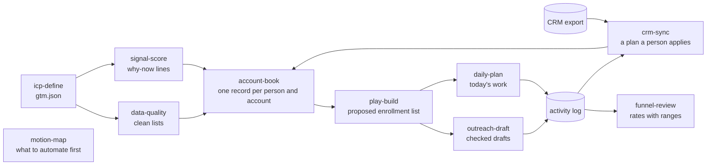

# Ten outbound skills that check their own work

**Summary:** I turned my own outbound method into ten agent skills for Claude Code and Codex, from defining the ICP to choosing what to automate. Every skill works on plain files and never sends, enrolls or writes to a CRM. Pressure tests found one failure and five weaker spots, I fixed them, and 365 unit tests now pass. Every result here is from runs on made-up data, not from a live sales team.

Built with AI-assisted development under my direction.

## Problem and intended outcome

Outbound breaks in the handoffs. The ICP lives in one place, the list in another, the signals in a third, and the CRM disagrees with all of them. An AI agent makes this worse when it guesses: it can enroll the wrong people, quote a fact it can't source, or write over a field someone fixed by hand.

I wanted a system an agent can run where each step has one job, passes files to the next step, and stops when a missing answer would change who gets contacted. It had to work with any CRM, sequencer or data vendor, and it had to keep a person in charge of every action that can't be undone.

## Who decided what

- **I decided:**
  - to build the skills from my own outbound method, on plain files, with no vendor lock-in (each [design record](design-records/) names its origin);
  - to fix every finding from the October review in one round (the "Revision 2026-10-22" section of each design record);
  - the stop rule: ask when the answer changes who is contacted, enrolled or written to, and otherwise use a stated default and name it ("Ask, don't guess" in the [play-build](design-records/play-build.md), [crm-sync](design-records/crm-sync.md) and [daily-plan](design-records/daily-plan.md) records);
  - to hold accounts whose only signal is research interest ("Intent alone is not a reason" in the [signal-score record](design-records/signal-score.md));
  - a 30-day default period for funnel reviews ("Default period" in the [funnel-review record](design-records/funnel-review.md));
  - to fix all seven findings from the second review ("Second review (Oct 22) findings fixed" in the design records);
  - to publish the skills as their own repository and keep raw test runs private (this repository).
- **I approved** the defaults that came out of the build, including one fit rule shared by four skills, signal expiry after 60 days for hiring and 30 for intent, and a 21-day wait before judging results for a group of prospects.
- The design records keep the reasoning behind each skill: [docs/design-records/](design-records/).

## How it works



Each skill is a short instruction file plus Python scripts. The scripts do the checking, so the agent can't call a list clean or a draft safe by itself. A few rules hold the system together:

- **One fit rule.** The same fit script, `gtm_fit.py`, is copied unchanged into the four skills that judge ICP fit, and [a test](../tests/test_gtm_shared.py) fails if the copies drift. An account can't fit in one step and fail in the next. A blank field means "find the missing data first", never "out".
- **Live deals are protected end to end.** An open deal in the CRM export flows through the account book to the play and the day plan, so outreach stops at that account. One test follows that chain through all four skills.
- **Do-not-contact always wins**, on every channel, in every skill that picks people or writes to them. An opt-out in the CRM becomes do-not-contact in the book in the same run.
- **Nothing acts on its own.** play-build proposes an enrollment list with every dropped account counted and explained. crm-sync writes a plan for a person to apply. outreach-draft's checker fails a number with no source, a greeting that names the wrong person, or a person the book hasn't cleared for that channel, and holds unproven claims for a person to review. A person ticks "sent" after sending each draft themselves.

## What went wrong and how it was corrected

I pressure-tested every skill, meaning I had separate AI sessions try to make each one misbehave, on five kinds of case: a normal request, an ambiguous one, a broken input, a missing tool, and a request it should not take. Across the ten skills that was 50 cases.

- **One failure.** Asked to "set up a win-back play for Q4" with no channel, dates or daily cap, play-build chose them itself instead of asking. It happened again on a repeat run, and the two runs chose different settings. So the list of people to contact depended on which run you got.
- **Five weaker spots that passed anyway.** Four skills (daily-plan, crm-sync, funnel-review, motion-map) assumed a default instead of asking. signal-score once marked an account ready to contact on research-interest data alone, which its own rules say is never a reason you can quote.

The fixes became rules in the skills and checks in the scripts. play-build's script now refuses a play that is missing its channel, start date, daily cap or sequence, and writes nothing ([design record](design-records/play-build.md)). An account whose only signals are research interest is held with the reason "intent only: find a citable reason first" ([design record](design-records/signal-score.md)).

A second, AI-assisted review pass then found seven more problems. For example, a manual strategy override could reopen an account with a live deal, and the copy checker flagged words like "two-minute" as unbacked numbers. All seven were fixed with tests and are listed in the design records under "Second review (Oct 22) findings fixed".

## Results

- **365 unit tests pass**, covering the scripts, the rules shared across skills and each example workspace (tested on the build machine).
- **49 of 50 pressure-test cases passed** before the fixes (October 21). The failure is the play-build case above.
- **Five reruns of the affected cases passed** after the fixes: play-build twice, then crm-sync, daily-plan and funnel-review once each.
- **The safety stops held** in the broken-input cases, for example a CRM export too short to trust, a time-zone typo, a bad setting, a broken motion map. No skill wrote the output its script refused to produce.

## Limits

- **All of it ran on made-up data.** Nothing here has been run against a real CRM, a real sequencer or real prospects, and nobody outside the project has used it yet.
- **The pressure tests were not fully independent.** AI helper sessions ran them, each in one turn and on one model, and they shared the running session's memory and tools. In one run, a stronger model passed the play-build case that failed, which suggests that failure depends on the model.
- **The raw test runs are not in this repository.** The counts above come from my private test records. What you can check here are the unit tests, the scripts and the design records.
- **Not every fix was rerun.** The motion-map and signal-score fixes are covered by unit tests only. daily-plan's rerun named its default in the reply but not in the plan file, and funnel-review's report shows its 30-day period without saying it was a default.
- **The reruns came before the second review.** The five reruns tested the first round of fixes; the seven later fixes are covered by unit tests only.
- **No Codex runs** were part of the pressure tests.

## Reproduce it

From the repository root, with Python 3:

```
python3 -m unittest discover -s tests -p "test_gtm_*.py"
```

Each skill folder also has a made-up example workspace under `assets/example/` that you can run its script against. The skill's `SKILL.md` gives the command.

## Evidence

| Claim | Where to check it | Proof label | Status | Note |
| --- | --- | --- | --- | --- |
| Plain files only; never sends, enrolls or writes to a CRM | [plugins/aym-gtm/skills/](../plugins/aym-gtm/skills/), each `SKILL.md` | local simulation | qualified | Built in and seen in the test runs; not proven for every possible request |
| One fit rule, identical in four skills | [tests/test_gtm_shared.py](../tests/test_gtm_shared.py), `SharedCopiesTests` | implementation tested | verified | |
| A blank field is never "out" | same file, `OneFitVerdictTests`, `TechStackRuleTests` | implementation tested | verified | |
| Live deals stop outreach end to end | same file, `LiveDealChainTests` | implementation tested | verified | Runs crm-sync, account-book, play-build and daily-plan in turn |
| Do-not-contact wins | [tests/test_gtm_crm_sync.py](../tests/test_gtm_crm_sync.py) `test_do_not_contact_wins_on_either_side`, `test_crm_opt_out_becomes_do_not_contact_in_the_same_run_and_is_never_lost`; [tests/test_gtm_data_quality.py](../tests/test_gtm_data_quality.py) `test_opted_out_and_note_block_every_channel`; [tests/test_gtm_play_build.py](../tests/test_gtm_play_build.py) `test_left_and_optout_tags_block` | implementation tested | verified | |
| What outreach-draft's checker catches | [tests/test_gtm_outreach_draft.py](../tests/test_gtm_outreach_draft.py) `test_unbacked_number_fails`, `test_greeting_must_match_the_person`, `test_book_gate_blocks_people_who_may_not_be_emailed`, `test_seller_claim_without_proof_needs_a_human` | implementation tested | verified | |
| play-build refuses missing settings | [build_play.py](../plugins/aym-gtm/skills/play-build/scripts/build_play.py) (the "play.json is missing" check); [tests/test_gtm_play_build.py](../tests/test_gtm_play_build.py) `test_missing_settings_stop_the_run_and_name_every_key` | implementation tested | verified | The test removes two of the settings; the script checks all of them |
| Intent-only accounts are held | [tests/test_gtm_signal_score.py](../tests/test_gtm_signal_score.py), `test_intent_only_account_is_held` | implementation tested | verified | |
| Seven second-review findings fixed | [design records](design-records/), "Second review (Oct 22) findings fixed" | implementation tested | verified | Six lines cover the seven fixes |
| 365 tests pass | the command above | implementation tested | verified | |
| 49 of 50 cases, five reruns | summarized in the [README](../README.md#results) | local simulation | verified | Checked against private test records that are not in this repository |
| All example data is made up | [account-book example](../plugins/aym-gtm/skills/account-book/assets/example/README.md) | implemented | verified | |
