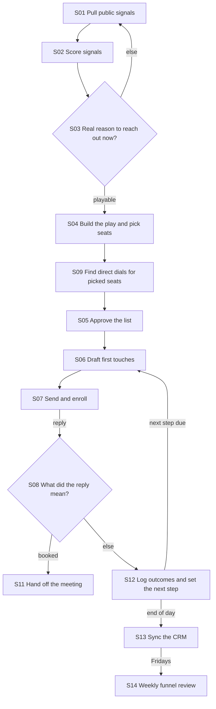

# Motion map: Ledgerline signal-led outbound

One rep, a scheduled builder and an executor run signal-led outbound to finance teams. All data is made up.

Checks: **clean**. Details in checks.md.

## Flow

## Roles and systems

| Role | Kind | What it may do |
| --- | --- | --- |
| rep | human | calls, judges, approves, sends |
| ae | human | calls, judges, approves, sends |
| builder | scheduled_builder | writes files and plans only, never touches live tools |
| executor | executor | applies approved plans only, never writes copy or picks who to contact |

| System | Live | One operator |
| --- | --- | --- |
| GTM workspace files | no | builder |
| Activity log file | no | rep |
| Your sequencer | yes | rep |
| Your calendar | yes | rep |
| Your CRM | yes | executor |

## Stage table

| Stage | Kind | Trigger | Work | Owner | Tier | Level | Volume/week | Waste |
| --- | --- | --- | --- | --- | --- | --- | --- | --- |
| S01 Pull public signals | task | clock | mechanical | builder | automatic | draft | 5 | none |
| S02 Score signals | task | event | mechanical | builder | automatic | draft | 5 | none |
| S03 Real reason to reach out now? | decision | event | mechanical | builder | batch | suggest | 0 | none |
| S04 Build the play and pick seats | task | event | mechanical | builder | batch | suggest | 1 | none |
| S09 Find direct dials for picked seats | task | event | mechanical | rep | manual | none | 20 | waiting |
| S05 Approve the list | task | event | judgment | rep | manual | none | 1 | waiting |
| S06 Draft first touches | task | event | judgment | builder | batch | draft | 40 | rework |
| S07 Send and enroll | task | event | mechanical | rep | manual | none | 40 | none |
| S08 What did the reply mean? | decision | event | judgment | rep | manual | none | 0 | none |
| S11 Hand off the meeting | task | event | judgment | rep | manual | none | 3 | none |
| S12 Log outcomes and set the next step | task | event | mechanical | rep | manual | none | 200 | manual |
| S13 Sync the CRM | task | event | mechanical | executor | batch | draft | 200 | none |
| S14 Weekly funnel review | task | clock | judgment | rep | manual | none | 1 | none |

## Stage cards

### S01 Pull public signals

- Trigger: clock: weekdays at 7am
- Work: mechanical. Owner: builder. Can't be undone: no
- Inputs: saved public searches. Outputs: signals/raw/<date>/
- Automation: tier automatic, level draft
- What a person reads: signals/raw pull folder
- Approval point: -
- Off switch: pause file in signals/

### S02 Score signals

- Trigger: event: -
- Work: mechanical. Owner: builder. Can't be undone: no
- Inputs: signals/raw. Outputs: signals/scored.csv
- Automation: tier automatic, level draft
- What a person reads: signals/report.md
- Approval point: -
- Off switch: pause file in signals/

### S03 Real reason to reach out now?

- Trigger: event: -
- Work: mechanical. Owner: builder. Can't be undone: no
- Inputs: -. Outputs: -
- Automation: tier batch, level suggest
- What a person reads: playable list with why-now lines
- Approval point: rep reads the playable list
- Off switch: skip the play

### S04 Build the play and pick seats

- Trigger: event: -
- Work: mechanical. Owner: builder. Can't be undone: no
- Inputs: signals/scored.csv, book/people.csv. Outputs: plays/<id>/enroll.csv
- Automation: tier batch, level suggest
- What a person reads: plays/<id>/funnel.md
- Approval point: rep marks approved rows
- Off switch: do not run build_play

### S09 Find direct dials for picked seats

- Trigger: event: -
- Work: mechanical. Owner: rep. Can't be undone: no
- Inputs: -. Outputs: -
- Automation: tier manual, level none
- What a person reads: -
- Approval point: -
- Off switch: -

### S05 Approve the list

- Trigger: event: -
- Work: judgment. Owner: rep. Can't be undone: no
- Inputs: -. Outputs: -
- Automation: tier manual, level none
- What a person reads: enroll.csv with drop reasons
- Approval point: rep writes yes in approved
- Off switch: -

### S06 Draft first touches

- Trigger: event: -
- Work: judgment. Owner: builder. Can't be undone: no
- Inputs: -. Outputs: -
- Automation: tier batch, level draft
- What a person reads: outreach/drafts/<date>.md and the lint report
- Approval point: rep reads each draft before sending
- Off switch: do not draft

### S07 Send and enroll

- Trigger: event: -
- Work: mechanical. Owner: rep. Can't be undone: yes
- Inputs: -. Outputs: -
- Automation: tier manual, level none
- What a person reads: each draft
- Approval point: rep presses send in the sequencer
- Off switch: -

### S08 What did the reply mean?

- Trigger: event: -
- Work: judgment. Owner: rep. Can't be undone: no
- Inputs: -. Outputs: -
- Automation: tier manual, level none
- What a person reads: -
- Approval point: rep reads every reply
- Off switch: -

### S11 Hand off the meeting

- Trigger: event: -
- Work: judgment. Owner: rep. Can't be undone: yes
- Inputs: -. Outputs: -
- Automation: tier manual, level none
- What a person reads: -
- Approval point: rep sends the invite
- Off switch: -

### S12 Log outcomes and set the next step

- Trigger: event: -
- Work: mechanical. Owner: rep. Can't be undone: no
- Inputs: -. Outputs: -
- Automation: tier manual, level none
- What a person reads: log/activity.csv
- Approval point: -
- Off switch: -

### S13 Sync the CRM

- Trigger: event: -
- Work: mechanical. Owner: executor. Can't be undone: no
- Inputs: -. Outputs: -
- Automation: tier batch, level draft
- What a person reads: sync/to-crm.csv pilot rows
- Approval point: rep approves the pilot rows, then the batch
- Off switch: no approved plan, no run

### S14 Weekly funnel review

- Trigger: clock: Fridays
- Work: judgment. Owner: rep. Can't be undone: no
- Inputs: -. Outputs: -
- Automation: tier manual, level none
- What a person reads: funnel/report.md
- Approval point: -
- Off switch: -

## RACI

| Stage | Does it (R) | Owns it (A) | Asked (C) | Told (I) |
| --- | --- | --- | --- | --- |
| S01 | builder | rep | - | - |
| S02 | builder | rep | - | - |
| S03 | builder | rep | - | - |
| S04 | builder | rep | - | - |
| S09 | rep | rep | - | - |
| S05 | rep | rep | - | - |
| S06 | builder | rep | - | - |
| S07 | rep | rep | - | - |
| S08 | rep | rep | - | - |
| S11 | rep | rep | - | ae |
| S12 | rep | rep | - | - |
| S13 | executor | rep | - | - |
| S14 | rep | rep | - | ae |

## Exceptions

| Stage | Usually | Sometimes |
| --- | --- | --- |
| S07 | send from the sequencer | a reply in an old thread is sent by hand |
| S12 | outcome logged the same day | voicemails logged the next morning |

## Waste at handoffs

waiting: 2, rework: 1, manual: 1.
- S09: waiting
- S05: waiting
- S06: rework
- S12: manual

## Readiness

| Stage | Visible today | Missing | Cleanup first |
| --- | --- | --- | --- |
| S01 | job posts, leadership news, funding news | - | - |
| S02 | accounts with domains, signal weights in gtm.json | - | - |
| S03 | playable gate | - | - |
| S04 | send gate, seat rules | - | - |
| S09 | phone type per person | about 1 in 3 picked seats has no direct dial | run data-quality and work the enrich list |
| S05 | counted drops per rule | - | - |
| S06 | copy rules, proof registry, why-now lines | - | - |
| S07 | send gate yes | - | - |
| S08 | reply outcomes list | - | - |
| S11 | meeting notes template | - | - |
| S12 | outcome list, activity log columns | - | - |
| S13 | record ids on every row, field mapping table | - | - |
| S14 | activity log, enrollments | - | - |

## Decision ownership

| Decision | Question | Owner | Exact fact | Consequential | If wrong | Check | Accountable |
| --- | --- | --- | --- | --- | --- | --- | --- |
| S03 | Is there a dated, sourced reason to reach out now? | rule | yes | yes | a cold account gets a timing message with no real reason | the playable gate in the scorer | rep |
| S08 | Is this a booked meeting, a not now, a no, or something else? | human | no | yes | a booked meeting is logged as not now and the follow-up goes out anyway | rep reads every reply | rep |

## Automate first

**S12 Log outcomes and set the next step**: move from level none to observe.

- Repetitive: about 200 items a week, about 400 minutes a week by hand.
- Where deals go cold: cold rate 0.3.
- Risk if automated wrong: low. Risk if left manual: high.
- Build order: do it once by hand and watch it work, turn the steps into a skill or script, wrap it in a loop with stop rules, schedule it last.
- Before it runs on a schedule, answer the loop check: does it repeat weekly or more, can an automatic check fail the work, does a budget cap retries, can it see its own results? Keep a state file with a do-not-retry list. Judge it by the share of runs whose changes are accepted; below 0.5, fix it or turn it off.

Next in line: S04 Build the play and pick seats.

Not ready yet (clean these first):
- S09 Find direct dials for picked seats: run data-quality and work the enrich list

Left out of the pick:
- S13 Sync the CRM: already at the top automation level (draft); a person keeps the final step.

Nothing here changes a tool, a CRM or a schedule. A person decides and builds each change.
